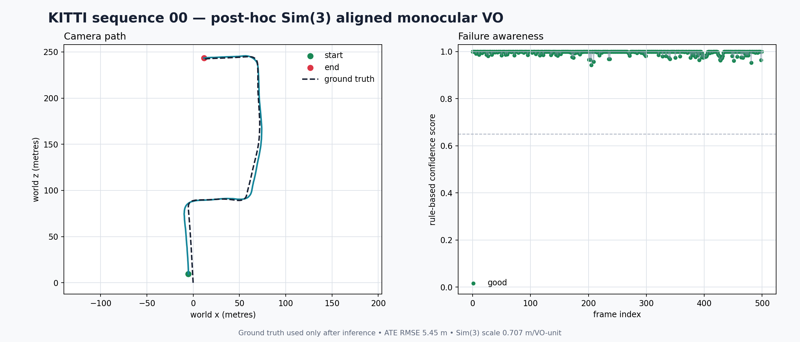
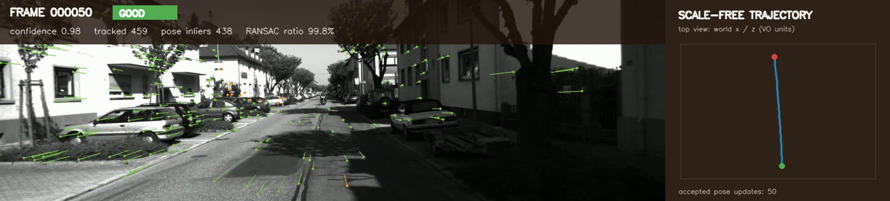
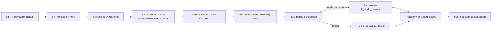

# Failure-Aware Monocular Visual Odometry

A classical monocular visual-odometry pipeline built with Python, OpenCV, and NumPy. It tracks
Shi–Tomasi corners with pyramidal Lucas–Kanade optical flow, rejects geometric outliers with
essential-matrix RANSAC, recovers relative camera motion, and accumulates a scale-ambiguous
`T_world_camera` trajectory. Each update also receives a rule-based confidence state so estimation
failures are recorded and handled instead of crashing the run.

The repository is designed as a compact learning project: the geometry, coordinate conventions,
scale limitation, diagnostics, and evaluation procedure are explicit in the code and documentation.




## What this project demonstrates

- Calibrated monocular camera geometry
- Shi–Tomasi feature detection and feature replenishment
- Pyramidal Lucas–Kanade tracking with forward–backward validation
- Essential-matrix estimation with RANSAC
- Relative rotation and translation-direction recovery
- Consistent SE(3) pose composition
- Honest handling of monocular scale ambiguity
- Per-frame confidence scoring and graceful failure recovery
- Post-hoc Umeyama Sim(3) alignment and trajectory evaluation
- Reproducible CSV, JSON, trajectory, plot, and MP4 artifacts

## Demo

The `--save-video` option creates `demo.mp4`. Green vectors are pose inliers; orange vectors are
tracked correspondences rejected by pose recovery. The header shows confidence, track count,
pose-inlier count, and RANSAC ratio. The right panel shows the raw scale-free path growing online.



The MP4 is generated locally under `outputs/` and is intentionally excluded from Git. A short GIF
or hosted video can be added here when publishing a project release.

## Pipeline



For every new image, the estimator:

1. Tracks the active features from the previous frame.
2. Removes failed, non-finite, out-of-bounds, and forward–backward-inconsistent tracks.
3. Estimates an essential matrix from calibrated correspondences with RANSAC.
4. Uses `cv2.recoverPose` to select a physically valid relative pose.
5. Scores the update from geometric support, spatial coverage, flow, and temporal consistency.
6. Accumulates an accepted pose or holds the previous pose after a failure.
7. Replenishes features when the active inlier set falls below the configured threshold.

The estimator never reads ground-truth poses. Ground truth is loaded only after inference when
`sim3_aligned` evaluation is requested.

## Essential-matrix geometry

Let a pixel in the previous frame be represented by homogeneous coordinates
`p = [u, v, 1]^T`. Calibration converts it into a normalized camera ray:

$$
\mathbf{x} = \mathbf{K}^{-1}\mathbf{p}.
$$

For corresponding normalized rays $\mathbf{x}_1$ and $\mathbf{x}_2$, the epipolar constraint is

$$
\mathbf{x}_2^T \mathbf{E}\mathbf{x}_1 = 0,
\qquad
\mathbf{E} = [\mathbf{t}]_\times \mathbf{R}.
$$

`R` rotates points from the previous camera frame into the current camera frame, and `t` is the
translation direction in the current camera frame. RANSAC repeatedly estimates `E` from small
samples and retains correspondences consistent with one model. `recoverPose` decomposes `E` and
uses the cheirality condition—triangulated points must lie in front of both cameras—to choose among
the four possible rotation/translation solutions.

The decomposition provides three rotation degrees of freedom and two translation-direction degrees
of freedom. Translation magnitude is not observable from two monocular images.

## Coordinate convention

OpenCV returns the relative transform `T_current_previous`:

```text
X_current = R_current_previous @ X_previous + t_current_previous
```

This project stores camera-to-world poses named `T_world_camera`. They map camera-frame points into
the arbitrary world frame established by frame zero. Pose accumulation therefore inverts the
relative transform:

```text
T_world_current = T_world_previous @ inverse(T_current_previous)
```

The first pose is the identity matrix. A failed update appends the previous global pose again, so
the trajectory and diagnostics always contain one entry per input frame.

## Monocular scale ambiguity

If all scene depths and camera translations are multiplied by the same positive number, their
image projections remain unchanged. Monocular correspondences therefore determine translation
direction but cannot determine translation magnitude in metres.

This project supports two modes:

- `scale_free`: every accepted relative translation has unit length. Output positions are in
  arbitrary VO units; metric ATE is deliberately omitted.
- `sim3_aligned`: the complete scale-free trajectory is estimated first, then one Umeyama Sim(3)
  transform is fitted to ground truth for evaluation. This supplies one global scale, rotation,
  and translation after inference.

The saved `trajectory_estimated.txt` always contains the raw scale-free estimate. Sim(3) alignment
cannot remove accumulated drift or correct inconsistent scale from one interval to another. The
project does not present ground-truth inter-frame scale as part of the normal algorithm.

## Requirements

- Python 3.10 or newer
- A CPU with enough memory to hold two KITTI frames and the active feature set
- KITTI Visual Odometry images, calibration, timestamps, and optional ground-truth poses

Core dependencies are OpenCV, NumPy, SciPy, Matplotlib, PyYAML, and tqdm. pytest and Ruff are
included in the development extra. A GPU is not required.

## Installation

Clone the repository after creating the GitHub remote:

```bash
git clone https://github.com/<your-github-username>/fa-monovo.git
cd fa-monovo
```

Create a clean environment and install the package in editable mode:

```bash
conda create -n monovo python=3.10 -y
conda activate monovo
python -m pip install --upgrade pip
python -m pip install -e ".[dev]"
```

The current development machine also uses an existing environment named `sam2`; the package does
not depend on SAM or a GPU.

Verify the installation:

```bash
monovo --version
python -c "import cv2, numpy, monovo; print(cv2.__version__, monovo.__version__)"
```

## KITTI dataset setup

This project was tested with the
[KITTI Odometry Kaggle mirror](https://www.kaggle.com/datasets/hocop1/kitti-odometry).
Install KaggleHub and download it outside the repository history:

```bash
python -m pip install kagglehub

python - <<'PY'
import kagglehub

path = kagglehub.dataset_download("hocop1/kitti-odometry")
print(f"KITTI downloaded to: {path}")
PY
```

Expose the KaggleHub cache through the path used by the default configuration:

```bash
KITTI_CACHE="$(python -c 'import kagglehub; print(kagglehub.dataset_download("hocop1/kitti-odometry"))')"
mkdir -p data
ln -s "$KITTI_CACHE" data/kitti
readlink -f data/kitti
```

If `data/kitti` already exists, remove or rename that local path before creating the symbolic link.
The dataset itself must have this structure:

```text
data/kitti/
├── sequences/
│   └── 00/
│       ├── calib.txt
│       ├── times.txt
│       └── image_2/
│           ├── 000000.png
│           └── ...
└── poses/
    └── 00.txt
```

The pipeline uses rectified left-color frames from `image_2` and the matching `P2` projection
matrix. Images are decoded as grayscale because the classical tracker operates on intensity.
KITTI pose files describe rectified camera 0; evaluation converts them to the selected `P2` camera
using the fixed camera center recovered from the projection matrix.

Validate the local data before running VO:

```bash
python - <<'PY'
from monovo.datasets import KittiSequence

sequence = KittiSequence("data/kitti", sequence="00")
print(f"frames: {len(sequence)}")
print(f"image shape: {sequence.load_image(0).shape}")
print(f"camera matrix:\n{sequence.intrinsic_matrix}")
print(f"ground truth available: {sequence.has_ground_truth}")
PY
```

For the tested mirror, sequence 00 should report 4,541 frames with image shape `(376, 1241)`.
`data/` is ignored by Git, so the dataset will not be committed.

## Usage

The default smoke test processes 100 frames using `configs/kitti.yaml`:

```bash
monovo run --config configs/kitti.yaml
```

Run the 500-frame turning test used in the results below:

```bash
monovo run \
    --config configs/kitti.yaml \
    --sequence 00 \
    --max-frames 500 \
    --output-directory outputs/sequence_00_500 \
    --scale-mode sim3_aligned
```

Generate the annotated demo video:

```bash
monovo run \
    --config configs/kitti.yaml \
    --sequence 00 \
    --max-frames 100 \
    --scale-mode sim3_aligned \
    --save-video
```

Run without ground-truth evaluation:

```bash
monovo run \
    --config configs/kitti.yaml \
    --sequence 00 \
    --max-frames 500 \
    --scale-mode scale_free
```

Useful overrides:

| Option | Meaning |
|---|---|
| `--dataset-root PATH` | Override `dataset.root` from YAML |
| `--sequence 00` | Select a two-digit KITTI sequence |
| `--max-frames N` | Limit the number of processed frames |
| `--feature-detector shi_tomasi` | Select the implemented detector |
| `--minimum-features N` | Set the feature replenishment threshold |
| `--ransac-threshold PIXELS` | Set the essential-matrix inlier threshold |
| `--scale-mode MODE` | Choose `scale_free` or `sim3_aligned` |
| `--output-directory PATH` | Select the result directory |
| `--no-visualization` | Skip the trajectory PNG |
| `--save-video` | Write an annotated MP4 |
| `--log-level LEVEL` | Choose `DEBUG`, `INFO`, `WARNING`, or `ERROR` |

Run `monovo run --help` for the authoritative CLI reference. Invalid paths, sequence names,
thresholds, calibration entries, and dataset counts produce actionable errors.

## Output files

```text
outputs/sequence_00/
├── trajectory.png
├── trajectory_estimated.txt
├── metrics.json
├── frame_diagnostics.csv
└── demo.mp4                 # only when --save-video is enabled
```

`trajectory_estimated.txt` follows KITTI's text convention: each row contains the first three rows
of one 4 × 4 `T_world_camera` matrix in row-major order, for 12 floating-point values per frame.
Its translations use arbitrary VO units.

`frame_diagnostics.csv` contains one row per frame, including:

- confidence score, state, and reasons
- input, tracked, RANSAC-inlier, and pose-inlier counts
- tracking and inlier ratios
- median optical-flow magnitude and spatial coverage
- rotation and translation-direction changes
- feature re-detection and failure information
- measured estimator processing time

`metrics.json` records the coordinate convention, scale mode, timing, failures, aggregate inlier
ratio, evaluation metrics, and the fitted Sim(3) parameters. `outputs/` is ignored by Git except
for its `.gitkeep` placeholder.

## Evaluation metrics

- **ATE RMSE:** Euclidean camera-position RMSE after one complete-trajectory Sim(3) alignment.
- **Relative rotation error:** angular difference between estimated and ground-truth adjacent-frame
  rotations.
- **Translation-direction error:** angle between adjacent estimated and ground-truth displacement
  vectors. This remains meaningful without metric inter-frame scale.
- **RANSAC inlier ratio:** fraction of valid tracked correspondences supported by the essential
  matrix.
- **Failure counts:** number of `failed` and `degraded` confidence states.
- **Timing:** mean estimator processing time and its reciprocal FPS. Optional video encoding is
  excluded from this timing.

Metric translation-magnitude error is not reported because the default estimator cannot observe
monocular metric scale.

## Measured results

These are actual sequence 00 measurements using the committed configuration. They are development
smoke tests, not a claim of general real-time performance or a full KITTI leaderboard submission.

| Frames | ATE RMSE after Sim(3) | Mean rotation error | Mean direction error | Mean RANSAC ratio | Failed | Measured FPS |
|---:|---:|---:|---:|---:|---:|---:|
| 100 | 1.693 m | 0.130° | 2.403° | 96.45% | 0 | 58.34 |
| 500 | 5.450 m | 0.118° | 2.595° | 96.58% | 0 | 47.95 |

The 500-frame path recovers the major right and left turns. Its larger ATE shows accumulated drift:
accurate local geometry does not guarantee a globally accurate trajectory. All 500 frames were
classified as `good`, which also shows that the current confidence score measures local geometric
support more strongly than long-horizon consistency.

Use this template when evaluating another sequence or configuration:

| Sequence | Frames | Scale mode | ATE RMSE | Rotation error | Direction error | Failures | FPS |
|---|---:|---|---:|---:|---:|---:|---:|
| `XX` | `N` | `sim3_aligned` | `... m` | `...°` | `...°` | `...` | `...` |

## Failure awareness

The rule-based confidence score combines tracked-feature count, RANSAC-inlier count, inlier ratio,
and spatial coverage. Hard checks also consider median optical flow and minimum geometric support.
Sudden rotations or translation-direction changes lower confidence.

- `good`: strong geometric support and no temporal warning
- `degraded`: pose accepted, but confidence or temporal consistency is weaker
- `failed`: pose unavailable or hard validity threshold violated

After a failure, the global pose is held, features are reinitialized in the current image, and the
reason is written to diagnostics. Confidence is a heuristic score, not a calibrated probability.

## Failure cases and limitations

- Pure rotation or very small translation gives weak translation observability.
- Forward motion concentrates flow near the focus of expansion and weakens triangulation.
- Repetitive textures can produce geometrically plausible incorrect matches.
- Moving vehicles and pedestrians violate the static-scene model.
- Motion blur, low light, shadows, and textureless road regions reduce reliable tracks.
- Frame-to-frame unit translations cause scale distortion when vehicle speed changes.
- Sequential accumulation drifts because the MVP has no bundle adjustment or loop closure.
- The current confidence model can remain high while small local errors accumulate globally.
- Only Shi–Tomasi plus Lucas–Kanade is implemented as the production path.
- Evaluation requires KITTI poses; sequences 11–21 can run scale-free but lack public ground truth.

## Repository structure

```text
fa-monovo/
├── configs/
│   └── kitti.yaml
├── docs/
│   └── assets/
├── outputs/
│   └── .gitkeep
├── scripts/
│   ├── create_dataset_visualizations.py
│   ├── evaluate_odometry_demo.py
│   ├── run_odometry_demo.py
│   ├── visualize_features.py
│   ├── visualize_optical_flow.py
│   └── visualize_ransac.py
├── src/monovo/
│   ├── datasets/kitti.py       # images, calibration, timestamps, poses
│   ├── features.py             # Shi–Tomasi detection and replenishment
│   ├── tracking.py             # pyramidal LK and track filtering
│   ├── geometry.py             # essential matrix and recoverPose
│   ├── odometry.py             # sequence loop and SE(3) accumulation
│   ├── confidence.py           # good/degraded/failed classification
│   ├── alignment.py            # Umeyama Sim(3)
│   ├── evaluation.py           # trajectory and motion metrics
│   ├── outputs.py              # TXT, CSV, and JSON serialization
│   ├── visualization.py        # trajectory plots and MP4 rendering
│   ├── config.py               # typed YAML construction
│   └── cli.py                  # monovo command
├── tests/
├── .gitignore
├── pyproject.toml
├── LICENSE
└── README.md
```

## Development checks

```bash
pytest
ruff check .
ruff format --check .
```

The tests cover synthetic essential-matrix recovery, pose conventions, failed-frame handling,
Umeyama alignment, evaluation, KITTI parsing, confidence classification, serialization, CLI
validation, and visualization-frame composition. Synthetic geometry tests use fixed random seeds.

## Future improvements

- Stereo scale recovery
- Camera–IMU fusion
- Bundle adjustment
- Keyframe selection
- Loop closure
- ROS 2 integration
- C++ implementation
- Sparse triangulation and an optional COLMAP comparison
- Confidence calibration using longer-horizon consistency

These are deliberately outside the MVP so the classical monocular pipeline remains understandable.

## Resume-ready description

> Built a failure-aware monocular visual-odometry system in Python using Shi–Tomasi features,
> pyramidal Lucas–Kanade tracking, essential-matrix RANSAC, calibrated pose recovery, and explicit
> SE(3) composition. Added rule-based failure handling, post-hoc Umeyama Sim(3) alignment, KITTI
> trajectory evaluation, deterministic synthetic tests, per-frame diagnostics, and annotated video
> export through a typed CLI.

## License

Released under the MIT License. See [LICENSE](LICENSE).
